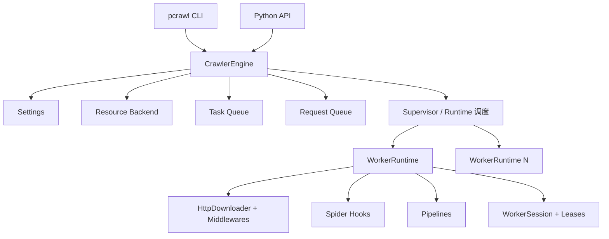
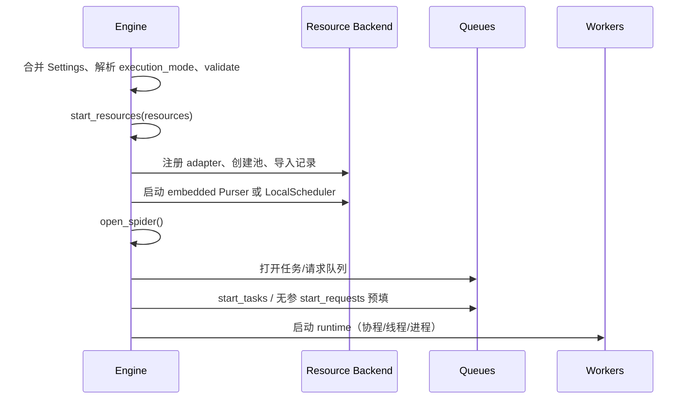
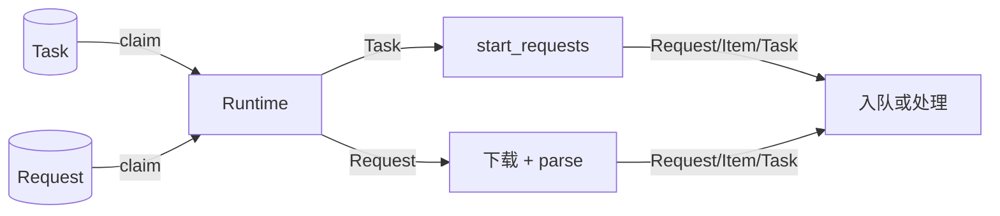
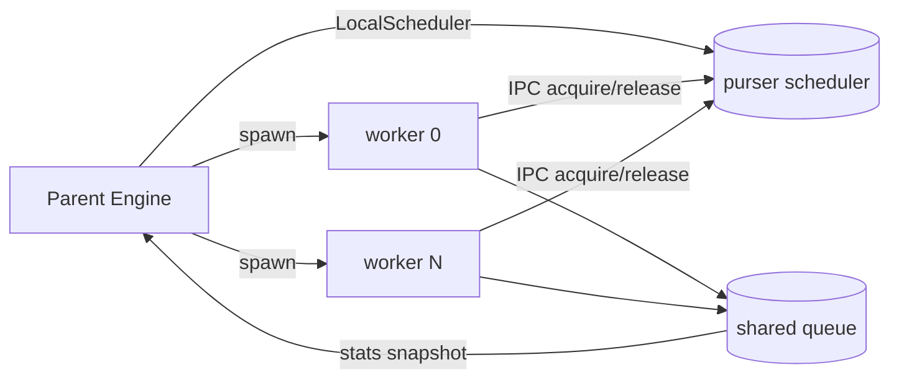

# 整体架构

pcrawl 是一个单包运行时：引擎负责生命周期，worker 负责调度，Spider 只描述“任务从哪来、请求怎么发、结果怎么处理”。

## 分层



| 层 | 职责 | 不负责 |
| --- | --- | --- |
| `CrawlerEngine` | 设置合并、模式解析、资源/队列生命周期、worker 调度、统计汇总 | 业务解析、具体资源协议 |
| `WorkerRuntime` | claim、重试、会话、组件调用、回调分发 | 队列实现、资源池实现 |
| `Spider` | 生成 task、构造 request、解析响应、会话钩子 | 调度、租约生命周期 |
| Queue | 存储与 claim/ack/nack | 业务重试策略 |
| Resource Backend | 租约获取/续租/归还 | 账号/browser 的具体用法 |

## 启动阶段



关键顺序：

1. 资源先于队列和 worker；
2. `open_spider` 在资源就绪后、worker 启动前；
3. `start_tasks` 在 seed 会话中执行，结束后释放 seed 租约；
4. 队列打开后才开始 claim。

## 双队列调度

worker 在 task 队列和 request 队列之间轮转，避免“任务生成请求”阶段饿死已有请求：



- task 是业务单元，request 是 HTTP 单元；
- task 的 `start_requests` 与 request 的 `parse` 都可以继续产出 task/request/item；
- 两个队列都支持 `fifo` / `priority`，重试通过 `nack(delay)` 回到队列。

## 会话模型

每个 worker 反复“开会话 → 处理若干条目 → 关会话”：

```text
WorkerRuntime.run
└── while 未停止:
    ├── 队列为空? → 退出或 keep_alive
    ├── open_session: Spider.open_session 中 session.acquire(...)、按需启动心跳
    ├── _run_session:
    │   ├── claim task → start_requests → consume
    │   └── claim request → 请求级租约 → 下载 → parse → consume
    └── close_session: Spider.close_session → release_all
```

会话级租约由 Spider 在 `open_session` 中显式获取，请求级租约只在单次请求期间持有。`session.user` 是 worker 本地状态，用于放客户端、浏览器上下文等不可序列化对象。

## 模式差异

| 方面 | inline | async | thread | process |
| --- | --- | --- | --- | --- |
| runtime 数 | 1 | `concurrency` | `workers` 线程 × 1 | `workers` 进程 × 1 |
| Spider 实例 | 共享 1 个 | 共享 1 个 | 共享 1 个 | 每进程独立 |
| 资源后端 | embedded | embedded | local | local |
| 队列 | 进程内 | 进程内 | 进程内/Redis | 共享内存/Redis |
| 统计 | 共享 | 共享 | 共享 | 子进程结束合并 |
| 信号 | 共享 | 共享 | 共享 | 子进程默认不回调父进程处理器 |

`open_spider` / `close_spider` 只在父进程调用一次；`open_session` / `close_session` 按 worker 会话调用。

## 进程模式



- 父进程拥有 `LocalScheduler` 和队列；
- 子进程通过 `SchedulerAddress` 连接，不创建自己的 scheduler；
- 资源类通过 `module:qualname` 注册，子进程 `load_object` 恢复；
- 父进程等待子进程，超时后终止；当前不自动重启；
- 统计在子进程退出时通过 `multiprocessing.Queue` 汇总一次。

## 设计约束

- **模式由类决定**：`execution_mode` 不是配置项，避免“类一种、配置另一种”。
- **模式适配收进 `ResourceRuntime`**：Spider 只写 purser 原生 API，embedded/local 的差异由门面在运行期选择。
- **资源对象归用户**：框架只托管租约，账号、浏览器、代理客户端由 Spider 创建和关闭。
- **队列只做存储**：重试次数、延迟、优先级调整由 runtime 决定，队列只执行 claim/ack/nack。
- **无资源可运行**：没有池时 `auto` 解析为 `off`，不导入 purser。

## 源码入口

| 文件 | 内容 |
| --- | --- |
| `pcrawl/engine.py` | 生命周期、模式解析、进程 supervisor |
| `pcrawl/runtime.py` | claim、重试、会话、回调 |
| `pcrawl/resources.py` | 资源门面、后端选择、租约视图 |
| `pcrawl/queue.py` | 内存/共享内存/Redis 队列 |
| `pcrawl/spider.py` | Spider 基类与上下文 |
| `pcrawl/settings.py` | 分层配置与别名 |
| `pcrawl/cli.py` | `pcrawl run` |
