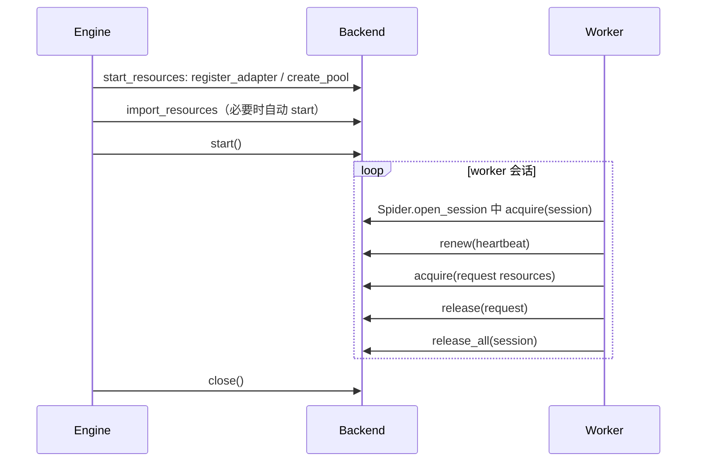

# 资源后端

pcrawl 不实现资源池，只实现三种后端适配，把统一的 `ResourceBackend` 接口映射到 purser 的不同运行形态。

## 接口

```python
class ResourceBackend:
    async def start(self) -> None: ...
    async def close(self) -> None: ...
    async def acquire(self, pool, *, request: Mapping[str, Any]) -> LeaseHandle: ...
    async def release(self, handle, *, outcome, used) -> bool: ...
    async def renew(self, handle) -> bool: ...
    async def import_resources(self, pool, records, **kwargs): ...
    async def stats(self, pool): ...
```

`ResourceManager` 是引擎持有的薄包装：把 `AcquireRequest` / mapping 归一化成普通 dict，注入 `consumer`，再转发给后端。

## 三种实现

| 实现 | 触发条件 | 资源对象 | 池所有者 |
| --- | --- | --- | --- |
| `_NoopBackend` | 无池且 `auto`，或显式 `off` | 无 | 无 |
| `_EmbeddedBackend` | `inline` / `async` + `auto`，或显式 `embedded` | 原对象直接可用 | 当前进程的 `Purser` |
| `_LocalBackend` | `thread` / `process` + `auto`，或显式 `local` | 通过 IPC/类型注册恢复 | 父进程 `LocalScheduler` |

### 选择逻辑

```text
purser_mode != auto → 使用显式值
purser_mode == auto:
    pools 为空           → off
    mode 为 inline/async → embedded
    mode 为 thread/process → local
```

注意：

- 旧的 `Spider.resources` 类变量 → 启动时 `ConfigError`，必须改用 `start_resources(resources)`；
- 显式 `off` + `create_pool(...)` → `ConfigError`；
- 显式 `embedded` + `thread/process` → 构造引擎时 `ConfigError`；
- 显式 `local` + `inline/async` 是允许的，worker 通过 IPC 访问父进程 scheduler。

## `_NoopBackend`

没有池时使用，行为是：

- `start` / `close` 空操作；
- 不导入 purser；
- `acquire` 抛 `ResourceUnavailable`；
- `import_resources` / `stats` 抛 `ResourceUnavailable`。

这是“普通 HTTP 采集不需要资源”的默认路径。无池时不会创建 scheduler（见 `test_process_mode_runs_without_resources`），purser 只在 `embedded` / `local` 后端路径中才会被导入。

## `_EmbeddedBackend`

由 `ResourceRuntime` 在引擎进程内创建 `purser.Purser`，`_EmbeddedBackend` 只是它的视图：

```python
Purser(
    storage=settings.purser_storage,
    coordination=settings.purser_coordination,
    sqlite_path=settings.purser_sqlite_path,
    redis_url=settings.purser_redis_url,
)
```

- 首次 `create_pool` 时创建 `Purser` 并注册 adapter；`start_resources` 中的 `import_resources` 会自动 `start`；
- `_EmbeddedBackend.close()` 不关闭 `Purser`，生命周期归 `ResourceRuntime`；
- 每个池的 `config` 自动补 `lease_ttl=settings.lease_ttl`（可通过 `create_pool(..., lease_ttl=...)` 覆盖）；
- `acquire` 把归一化后的 request dict 转成 `AcquireRequest`，`LeaseHandle.resource` 就是原始对象；
- `release` 把 `outcome.value` 字符串化后传给 purser；
- `renew` 调用 `pool.renew_manual(raw)`；
- `import_resources` / `stats` 直接代理到池对象。

`inline` 和 `async` 的多个 runtime 共享同一个 `Purser` 与连接池。

## `_LocalBackend`

父进程创建 `purser.local.LocalScheduler` 并启动：

```python
scheduler = LocalScheduler(
    storage=..., coordination=..., sqlite_path=..., redis_url=...,
    start_method=settings.purser_start_method,
    adapters=adapters,
)
scheduler.start()
```

- 池在父进程中创建，worker 不创建池；
- worker 使用 `LocalSchedulerClient(address, resource_types=...)`；
- `acquire` / `release` / `renew` / `import_resources` / `stats` 通过 `asyncio.to_thread` 走同步 IPC，避免阻塞事件循环；
- `release` 传 `outcome.value`；
- `renew` 成功返回 `True`；
- `import_resources` / `stats` 也走 IPC。

`SchedulerAddress` 通过 `to_env()` / `from_env()` 在 supervisor 与子进程之间传递。

### 类型恢复

自定义资源类型跨进程需要两侧信息：

1. 父进程：`resources.register_adapter(...)` 注册到 `LocalScheduler`；
2. 子进程：`resource_types` 映射 `kind → module:qualname`，由 `resource_type_paths(adapters)` 生成并放进 worker config。

子进程启动时：

```python
for kind, path in config["resource_types"].items():
    resource_types[kind] = load_object(path)
backend = make_backend(settings, scheduler, resource_types=resource_types)
```

因此：

- 资源类必须在模块顶层、可导入；
- 局部类或 `<locals>` 不会生成路径；
- 导入失败会记录 warning，并退回通用 `Resource`；
- 退回时 `LeaseHandle.payload` 仍然可用，`LeaseHandle.resource` 不再是原始类型。

`thread` 模式同样使用 `_LocalBackend`，但 adapter 与 worker 在同一进程，类型注册仍然生效。

## 租约视图

无论哪种后端，Spider 只接触 `LeaseHandle`：

```python
handle.payload    # dict 快照
handle.resource   # 后端恢复的对象
handle.token
handle.resource_id
handle.tags
handle.mark_used()
handle.renew()
handle.release(outcome=ResourceOutcome.OK)
```

`WorkerSession.release_all()` 会先停止心跳，再逆序释放租约。

## 生命周期



`process` 模式下父进程关闭 `LocalScheduler`，子进程关闭自己的 client；资源池只由父进程回收。

## 失败语义

| 情况 | 结果 |
| --- | --- |
| 池不存在 | `ResourceUnavailable("unknown purser pool ...")` |
| 无可用资源 / 等待超时 | `ResourceUnavailable`，会话层重试到 `resource_wait_timeout` |
| 资源失效 | Spider 抛 `ResourceInvalid(outcome)`，租约按该 outcome 归还 |
| `use_limit` 超限 | `ResourceInvalid(QUOTA_EXHAUSTED)` |
| 心跳失败 | 记录 `session.heartbeat_error`，资源可能被后端回收 |
| 释放失败 | 记录异常，`release_all` 继续释放其余租约 |

## 存储与协调层

`storage` / `coordination` 直接传给 purser，pcrawl 不做额外解释：

| 参数 | 常见值 | 说明 |
| --- | --- | --- |
| `storage` | `memory` / `sqlite` / `mysql` | 资源与租约的持久化 |
| `coordination` | `memory` / `redis` | 跨进程/跨主机的协调 |
| `sqlite_path` | 文件路径 | SQLite 存储位置 |
| `redis_url` | `redis://...` | Redis 协调地址 |

`process` 模式若需要跨机器共享资源，使用 Redis 协调层；仅本机多进程时内存协调也够用，但父进程退出后状态不保留。
