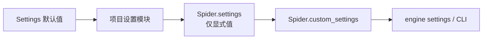

# 配置分层

pcrawl 的配置采用 Scrapy 风格的分层合并：默认值 → 项目设置 → Spider 设置 → 调用方覆盖。执行模式不在配置里，它只由 Spider 类决定。

## 合并顺序



优先级从低到高：

1. `Settings` 字段默认值；
2. 设置模块：`settings_module` 参数，否则环境变量 `PCRAWL_SETTINGS_MODULE`，否则 `pcrawl.cfg` 的 `[settings] default`；
3. `Spider.settings` 中**显式设置过**的值；
4. `Spider.custom_settings`；
5. `CrawlerEngine(..., settings={...})`，CLI 参数也走这一层。

!!! tip "Spider.settings 只覆盖显式值"
    写成 `settings = Settings(concurrency=4)` 时，只有 `concurrency` 进入覆盖层。
    未显式赋值的字段不会把默认值“压”回上一层，因此设置模块里的 `workers` 等仍然生效。

设置模块只读取大写名称：

```python
# myproject/settings.py
CONCURRENCY = 16
WORKERS = 4
REQUEST_MAX_RETRIES = 3
ITEM_PIPELINES = {"myproject.pipelines.JsonlPipeline": 100}
```

```python
from pcrawl import CrawlerEngine

engine = CrawlerEngine(MySpider, settings_module="myproject.settings")
```

`pcrawl.cfg` 只负责指向模块：

```ini
[settings]
default = myproject.settings
```

## Scrapy 风格别名

设置模块、`-s` 和 `custom_settings` 都接受 Scrapy 名称：

| Scrapy 名称 | pcrawl 字段 |
| --- | --- |
| `CONCURRENT_REQUESTS` | `concurrency` |
| `WORKERS` | `workers` |
| `MAX_RETRIES` / `RETRY_TIMES` | `request_max_retries` |
| `RETRY_DELAY` | `request_retry_delay` |
| `RETRY_HTTP_CODES` | `request_retry_http_codes` |
| `RETRY_PRIORITY_ADJUST` | `request_retry_priority_adjust` |
| `RETRY_MAX_DELAY` | `request_retry_max_delay` |
| `DOWNLOAD_TIMEOUT` | `download_timeout` |
| `USER_AGENT` | `user_agent` |
| `DOWNLOADER_MIDDLEWARES` | `downloader_middlewares` |
| `SPIDER_MIDDLEWARES` | `spider_middlewares` |
| `ITEM_PIPELINES` | `item_pipelines` |
| `PURSER_MODE` | `purser_mode` |
| `QUEUE_ORDER` / `REDIS_URL` / `REDIS_KEY` | 同名语义 |
| `LOG_LEVEL` | `log_level` |

未知的大写名称不会报错，会原样保存在 `Settings` 中，扩展可以用 `settings.get("MY_KEY")` 读取。

## 读取与修改

`Settings` 同时支持属性和映射式访问：

```python
from pcrawl import Settings

settings = Settings()
settings.set("CONCURRENT_REQUESTS", 8)
settings.update({"download_timeout": 15, "myplugin_batch": 100})

assert settings.getint("concurrency") == 8
assert settings.getfloat("download_timeout") == 15.0
assert settings.getbool("keep_alive") is False
assert settings.getlist("request_retry_http_codes") == [429, 500, 502, 503, 504]
assert settings["myplugin_batch"] == 100
assert settings.get("myplugin_batch") == 100
```

| 方法 | 说明 |
| --- | --- |
| `get` / `getint` / `getfloat` / `getbool` / `getlist` / `getdict` | 带类型转换的读取 |
| `set` / `update` / `setdefault` / `setdict` | 修改并记录为显式值 |
| `setmodule` / `from_module` | 从模块导入大写名称 |
| `load` | 按“默认值 → 模块 → overrides”加载 |
| `replace` / `copy` | 复制后修改，避免共享可变配置 |
| `to_dict` / `explicit_values` | 全量快照 / 仅显式覆盖 |
| `validate` | 引擎启动前校验枚举与数值边界 |

## 全部配置项

| 字段 | 默认 | 说明 |
| --- | --- | --- |
| `name` | `pcrawl` | worker id 前缀 |
| `workers` | `1` | `thread` 线程数 / `process` 进程数 |
| `concurrency` | `1` | `async` 模式的 runtime 数 |
| `idle_timeout` | `2.0` | 已开会话中持续无可领取条目时，等待多久退出会话 |
| `keep_alive` | `False` | worker 在队列空时是否继续等待新任务 |
| `queue_backend` | `memory` | `memory` / `redis` |
| `queue_order` | `fifo` | `fifo` / `priority` |
| `redis_url` | `redis://localhost:6379/0` | Redis 地址 |
| `redis_key` | `pcrawl` | Redis key 前缀 |
| `visibility_timeout` | `300.0` | Redis 在途条目的可见性超时 |
| `claim_poll_interval` | `0.2` | 空队列轮询间隔 |
| `task_max_retries` | `3` | task 默认最大重试次数 |
| `task_retry_delay` | `1.0` | task 重试延迟 |
| `request_max_retries` | `2` | request 默认最大重试次数 |
| `request_retry_delay` | `1.0` | request 基础重试延迟 |
| `request_retry_http_codes` | `(429, 500, 502, 503, 504)` | 触发重试的 HTTP 状态码 |
| `request_retry_priority_adjust` | `-1` | 重试时优先级调整 |
| `request_retry_max_delay` | `60.0` | `Retry-After` 延迟上限 |
| `request_dedup_ttl` | `0.0` | 请求去重 TTL；`0` 表示队列生命周期内永久 |
| `download_timeout` | `30.0` | 默认下载超时 |
| `user_agent` | `pcrawl/0.1` | 默认 User-Agent |
| `trust_env` | `False` | 是否读取系统代理环境变量 |
| `shutdown_timeout` | `30.0` | process 模式优雅退出等待时间 |
| `downloader_middlewares` | `()` | 下载器中间件声明 |
| `spider_middlewares` | `()` | Spider 中间件声明 |
| `item_pipelines` | `()` | Item Pipeline 声明 |
| `purser_mode` | `auto` | `auto` / `off` / `embedded` / `local` |
| `purser_storage` | `memory` | purser 存储层 |
| `purser_coordination` | `memory` | purser 协调层 |
| `purser_sqlite_path` | `None` | SQLite 路径 |
| `purser_redis_url` | `None` | purser Redis 地址 |
| `purser_start_method` | `spawn` | LocalScheduler 启动方式 |
| `resource_wait_timeout` | `30.0` | 等待会话资源的超时；`<=0` 表示一直等 |
| `lease_ttl` | `60.0` | 租约 TTL；会话按 `max(0.1, ttl/3)` 续租 |
| `mp_start_method` | `spawn` | multiprocessing 启动方式 |
| `log_level` | `INFO` | 日志级别 |
| `stats_interval` | `0.0` | 当前版本未实现周期输出，保留字段 |

## 并发参数的含义

| 模式 | 实际使用的字段 |
| --- | --- |
| `inline` | 无；固定 1 个 runtime |
| `async` | `concurrency` |
| `thread` | `workers`（每个线程 1 个 runtime） |
| `process` | `workers`（每个进程 1 个 runtime） |

`concurrency` 在 `thread` / `process` 中当前不参与调度；需要更高并发时增加 `workers`。

## 校验

`CrawlerEngine` 启动前调用 `settings.validate()`，以下情况直接报 `ConfigError`：

- `queue_backend`、`queue_order`、`purser_mode` 不在允许值内；
- `workers` / `concurrency` / 重试次数 / 去重 TTL 为负；
- `request_retry_max_delay < request_retry_delay`；
- 在设置里写了 `MODE` / `PCRAWL_MODE`；
- `thread` / `process` 显式使用 `purser_mode="embedded"`。

## 环境变量

| 变量 | 作用 |
| --- | --- |
| `PCRAWL_SETTINGS_MODULE` | 默认设置模块 |

`trust_env` 控制 httpx 是否读取 HTTP 代理相关环境变量，默认关闭。其他配置请通过设置模块或 `-s` 传入。

## CLI 覆盖

```bash
pcrawl run myproject.spiders.MySpider \
  --settings-module myproject.settings \
  -s CONCURRENT_REQUESTS=16 \
  -s DOWNLOAD_TIMEOUT=10 \
  -s myplugin_batch=100
```

`-s` 的值先尝试 `true` / `false`，再用 `ast.literal_eval` 解析；失败则作为字符串。详见 [CLI](../reference/cli.md)。
