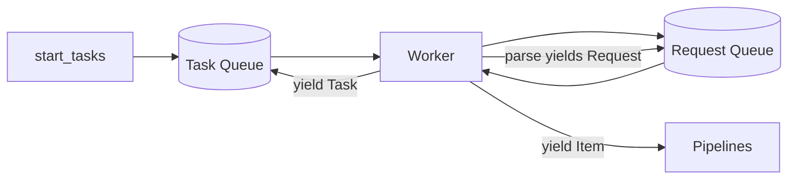

# 队列与持久化

pcrawl 有两个独立队列：任务队列（`Task`）和请求队列（`Request`）。worker 在两者之间轮询，不会把 task 和 request 混在同一个队列里。



## 后端选择

| `queue_backend` | `inline` / `async` | `thread` | `process` | 跨主机 |
| --- | --- | --- | --- | --- |
| `memory` | `MemoryTaskQueue` + `MemoryRequestQueue` | 同左，线程安全 | `multiprocessing.Manager` 共享内存队列 | 否 |
| `redis` | `RedisTaskQueue` + `RedisRequestQueue` | 同左 | 同左 | 是 |

- `memory` 队列在 worker 内 claim 后即从队列移除；进程崩溃会丢失在途条目。
- `process` 模式 + `memory` 使用共享内存，适合单机多进程，但没有 visibility timeout，崩溃后同样不恢复。
- `redis` 是生产模式：带 visibility timeout、延迟重试和请求去重。

## 任务队列

`Task` 是业务单元，不含 HTTP 字段：

```python
from pcrawl import AsyncSpider, Task


class Spider(AsyncSpider):
    def start_tasks(self):
        for page in range(1, 51):
            yield Task(route="list", payload={"page": page}, priority=10)
```

| 字段 | 说明 |
| --- | --- |
| `id` | 默认 `uuid4().hex`，Redis 以它作为数据主键 |
| `route` | 路由名，配合 `session_routes()` 做亲和调度 |
| `payload` | 业务数据，需可 JSON 序列化 |
| `priority` | 仅 `queue_order="priority"` 生效，数值越大越先出队 |
| `retries` / `max_retries` | 已重试次数和覆盖值 |
| `created_at` | 创建时间 |

task 的 `start_requests` 成功返回后即 ack；抛异常走重试，`IgnoreRequest` 直接 ack 并记 `task_ignored`。

## 请求队列

`Request` 是 HTTP 工作单元，支持从回调继续产出：

```python
def parse(self, response, ctx):
    for href in response.css("a::attr(href)").getall():
        yield response.follow(href, callback=self.parse_detail)
```

| 字段 | 说明 |
| --- | --- |
| `url` / `method` / `headers` / `body` | 请求内容 |
| `callback` / `errback` | 字符串、模块级函数或绑定方法 |
| `meta` / `cb_kwargs` | 透传数据与回调参数 |
| `priority` | 越大越先出队（priority 模式） |
| `dont_filter` | 跳过去重 |
| `route` | 路由名，决定 redis 的分桶 |
| `resources` | 请求级资源声明，key 为池名，value 为 `AcquireRequest` / mapping |
| `retries` / `max_retries` | 重试状态 |

### 去重

请求入队时按 `method + url + body` 生成指纹：

- `request.dont_filter=True` 或 `put(..., skip_dedup=True)` 跳过；
- `request_dedup_ttl=0`（默认）在进程/队列生命周期内永久去重；
- 设置正数后到期自动失效；
- memory 后端去重表在进程内存，Redis 后端跨 worker 共享。

被去重过滤的请求不会重新入队，也不会触发回调；stats 记为 `request_filtered`。

## 排序

| `queue_order` | 行为 |
| --- | --- |
| `fifo` | 按入队顺序 |
| `priority` | 先比 `priority`（大者优先），同优先级保持入队顺序 |

重试请求会把 `priority` 加上 `request_retry_priority_adjust`（默认 `-1`），避免失败请求挤占新请求。

## 重试与可见性

| 设置 | 默认 | 作用 |
| --- | --- | --- |
| `request_max_retries` | `2` | 请求默认最大重试次数 |
| `request_retry_delay` | `1.0` | 基础重试延迟 |
| `request_retry_max_delay` | `60.0` | `Retry-After` 延迟上限 |
| `request_retry_http_codes` | `(429, 500, 502, 503, 504)` | 视为失败的状态码 |
| `task_max_retries` | `3` | 任务默认最大重试次数 |
| `task_retry_delay` | `1.0` | 任务重试延迟 |
| `visibility_timeout` | `300.0` | Redis 在途条目的重新可见时间 |
| `claim_poll_interval` | `0.2` | 空队列轮询间隔 |

- Redis 任务/请求 claim 后写入 `processing` 和 deadline；超过 `visibility_timeout` 未 ack 会自动回到待处理队列。
- `nack(delay>0)` 在 Redis 中进入 delayed zset，到点后提升；memory 后端则是 worker 内 `sleep(delay)` 后再放回。
- HTTP `Retry-After` 优先于固定延迟，并受 `request_retry_max_delay` 限制。
- 有 `errback` 的请求失败时交给 errback，不自动重试；errback 自己 yield 的 Request 会正常入队。

## 路由与亲和

`Spider.session_routes(session)` 返回该会话可处理的路由集合，`None` 或不返回表示不限。worker 只 claim 匹配的路由，适合让持有特定账号/浏览器的会话处理对应任务：

```python
def session_routes(self, session):
    account = session.user["account"]
    return {f"account:{account['id']}"}
```

任务与请求的 `route` 都可以留空，空路由同样是一个合法分桶。

## 自定义队列

`CrawlerEngine` 接受外部队列：

```python
from pcrawl import CrawlerEngine, MemoryTaskQueue, MemoryRequestQueue

engine = CrawlerEngine(
    Spider,
    task_queue=MemoryTaskQueue(),
    request_queue=MemoryRequestQueue(),
)
```

队列需实现 `open` / `close` / `put` / `claim` / `ack` / `nack` / `size`。`process` 模式只接受 `SharedMemory*` 或 `Redis*` 队列，其他实现会在启动时报 `ConfigError`。

## 持久化边界

- Redis 队列保存的是 JSON：`Task.payload`、`Request.meta`、`cb_kwargs` 必须可序列化。
- `Request.callback/errback` 只能是字符串、模块级函数或绑定到 spider 的方法。
- 资源句柄、浏览器对象、数据库连接不要放进 `Task.payload` 或 `Request.meta`；会话状态放 `session.user`，进程内可用。
