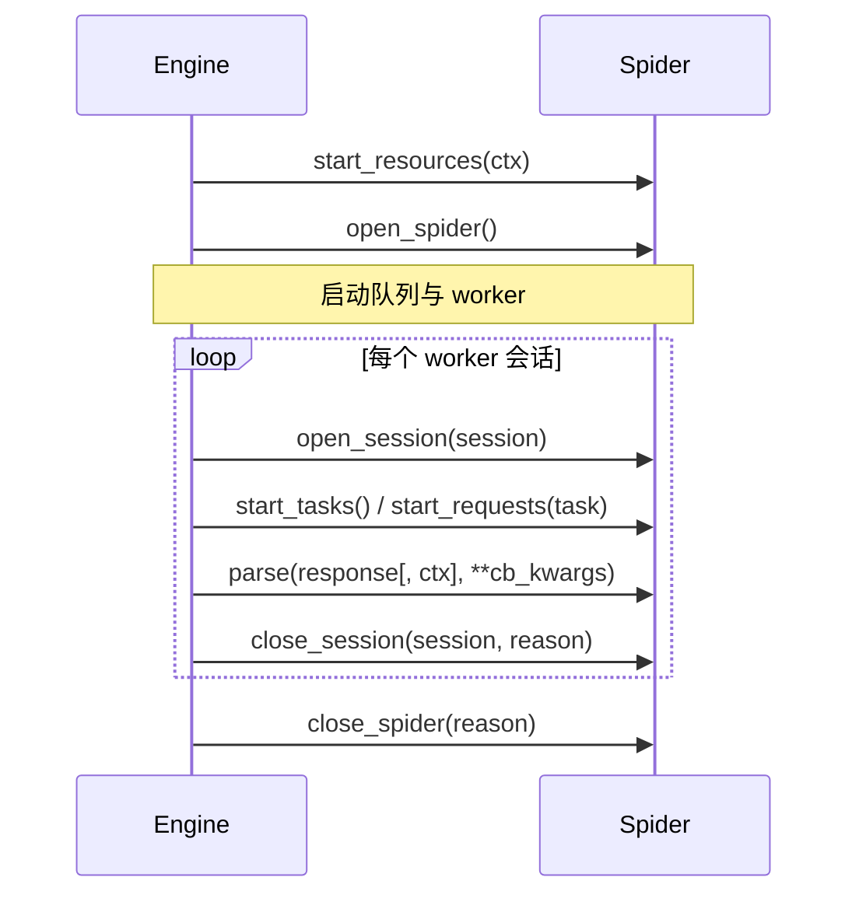

# Spider 钩子

`Spider` 子类通过类属性和钩子方法描述采集流程。所有钩子同步/异步均可，返回值按各方法约定处理。

## 类属性

| 属性 | 默认 | 说明 |
| --- | --- | --- |
| `execution_mode` | `"inline"` | 由基类决定，不要手改 |
| `name` | 类名 | worker id 与 logger 后缀 |
| `start_urls` | `()` | 基础 `start_tasks` 使用的 URL 元组 |
| `resources` | `None` | 逻辑名 → `ResourceSpec` 的映射或 `ResourcePlan` |
| `settings` | `None` | `Settings` 或映射，仅显式值覆盖上一层 |
| `custom_settings` | `{}` | Scrapy 风格的 per-spider 覆盖 |

模式基类：

| 基类 | `execution_mode` |
| --- | --- |
| `Spider` | `inline` |
| `AsyncSpider` | `async` |
| `MultiThreadSpider` | `thread` |
| `MultiProcessSpider` | `process` |

## 生命周期



## 方法与调用时机

### `start_resources(ctx=None)`

启动阶段调用一次，返回 `ResourceSetup` 或映射。用于声明池、seed、adapter 和后端参数。

```python
def start_resources(self, ctx=None):
    return ResourceSetup(pools={...})
```

- 返回 `None` 等价于空声明；
- 不能返回 live `Purser` / `ResourcePool`；
- 在 `open_spider` 之前、worker 启动之前执行。

### `setup_resources(resources, ctx=None)`

资源后端启动、seed 导入之后调用一次。`resources` 是 `ResourceManager`，用于惰性导入或生成资源。

### `open_spider()`

worker 启动前调用一次。`process` 模式只在父进程调用。适合初始化不跨进程的全局状态。

### `start_tasks(ctx=None)`

产出入队 `Task`。基础实现把每个 `start_urls` 变成 `Task(payload={"url": ...})`。

```python
def start_tasks(self):
    for row in load_rows():
        yield Task(payload=row)
```

- 只允许 `Task`；返回 `Request` / `Item` 会抛 `TypeError`；
- 该钩子在父进程的 seed 会话中执行，会话资源租约在结束后释放。

### `start_requests(task=None, ctx=None)`

把 task 转成零个或多个结果。支持调用形状：

- `start_requests()`：Scrapy 风格，只能 yield `Request`，由引擎预填请求队列；
- `start_requests(task)`；
- `start_requests(task, ctx)`。

每个 task 的结果可以包含 `Request`、`Item`、`Mapping` 或 `Task`：

```python
def start_requests(self, task, ctx):
    if task.payload.get("direct"):
        yield Item(source="inline", **task.payload)
        return
    yield Request(task.payload["url"], callback=self.parse)
```

基础实现要求 `task.payload["url"]`；自定义 payload 时覆写该方法。

### `parse(response, ctx=None, **cb_kwargs)`

默认回调。可 yield `Request`、`Item`、`Mapping`、`Task`，或返回异步生成器。

```python
def parse(self, response, ctx=None):
    yield Item(url=response.url, status=response.status)
```

回调签名还支持 `callback(response, **cb_kwargs)` 与 `callback(response, ctx, **cb_kwargs)`；带 `ctx` 时会自动注入。

### `open_session(session)` / `close_session(session, reason)`

每个 worker 会话开始/结束时调用：

```python
def open_session(self, session):
    account = session.get("account")
    session.user["client"] = Client(account.payload)

def close_session(self, session, reason):
    session.user["client"].close()
```

- 会话级资源已在此前获取；请求级资源不在这里；
- `open_session` 抛 `ResourceInvalid(outcome)` 会按该 outcome 归还租约并重建会话；
- `close_session` 抛异常只记日志，租约仍会释放；
- `process` 模式下每个子进程的 Spider 实例各调用一次。

### `session_routes(session)`

返回该会话可处理的路由集合，`None` 表示不限。worker 只 claim 匹配的 task/request。

### `bind_resource(request, name, handle)`

请求级资源获取后调用。默认写入：

```python
request.meta["pcrawl_resources"][name] = {
    "resource_id": handle.resource_id,
    "payload": handle.payload,
    "resource": handle.resource,
}
```

可覆写为客户端需要的结构。

### `on_task_error(task, exc, ctx)`

task 失败、决定重试或丢弃之前调用。用于记录失败原因；自身异常只记日志。

### `close_spider(reason)`

worker 全部结束后调用一次。`reason` 取值：

| 值 | 含义 |
| --- | --- |
| `finished` | 正常完成 |
| `error` | 运行抛出未捕获异常 |
| `CloseSpider.reason` | 主动关闭时传入的原因 |

## 上下文对象

### `ResourceContext`

`start_resources` / `setup_resources` 可用：

| 字段 | 说明 |
| --- | --- |
| `spider` | 当前 Spider 实例 |
| `settings` | 解析后的 `Settings` |
| `mode` | `inline` / `async` / `thread` / `process` |

### `SpiderContext`

回调、`start_tasks`、`on_task_error` 可用：

| 字段/方法 | 说明 |
| --- | --- |
| `spider` / `settings` / `session` | 当前实例、配置、会话 |
| `stats` / `signals` | 当前 worker 的统计与信号 |
| `worker_id` | worker 标识 |
| `runtime` / `downloader` | 内部运行时与下载器 |
| `ctx.get_lease(name)` | 获取会话级 `LeaseHandle` |
| `ctx.user` | `session.user` 的快捷方式 |

### `WorkerSession`

| 字段/方法 | 说明 |
| --- | --- |
| `id` / `worker_id` | 会话与 worker 标识 |
| `leases` | 逻辑名 → `LeaseHandle` |
| `user` | worker 本地可变状态 |
| `get(name)` / `session[name]` | 获取租约，缺失抛 `KeyError` |
| `acquire(name, spec=None)` | 额外获取租约 |
| `release(name, outcome=None, used=None)` | 释放单个租约 |
| `invalidate(outcome)` | 标记会话内全部租约为该 outcome |
| `start_heartbeat(interval)` / `stop_heartbeat()` | 手动控制续租 |
